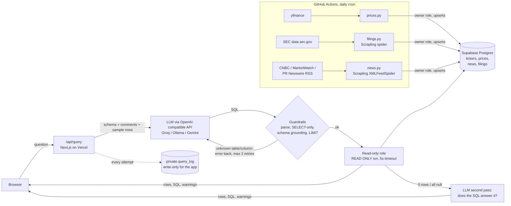

# market-sql

[](https://github.com/vtalla-hq/market-sql/actions/workflows/ci.yml)
[](https://github.com/vtalla-hq/market-sql/actions/workflows/ingest.yml)

**Ask stock market questions in plain English: an LLM writes Postgres SQL, six guardrails check it, and it runs read-only, measured against a 55-question eval.**

**Live demo:** LIVE_URL_PLACEHOLDER

<!-- TODO(vtalla): record a 30s demo GIF (ask a chip question, open the SQL, show the chart, then try "drop the prices table") and embed it here:  -->

50 S&P 500 stocks across all 11 sectors: 5 years of daily prices, SEC filings (8-K, 10-Q, 10-K, Form 4) and business news, refreshed daily.

## Architecture



## Guardrails

1. **Read-only DB role.** The app connects as `market_sql_app`: `SELECT` on the four data tables only, `statement_timeout = 5s`, and every query runs inside a `READ ONLY` transaction that is rolled back.
2. **Parser checks** (`node-sql-parser`, PostgreSQL): reject unparseable SQL, more than one statement, anything that isn't a `SELECT` (including writes nested in CTEs and `SELECT INTO`), SQL comments and dollar quoting, other schemas (`information_schema`, `pg_catalog`, `private`), and server functions (`pg_sleep`, `pg_read_file`, `set_config`, ...).
3. **Schema grounding.** Every table and column must exist in the real schema (loaded from `information_schema` at startup). Unknown identifiers count as hallucinations: the error goes back to the LLM, up to 2 retries, then a clear failure. The model can also answer `CANNOT_ANSWER` instead of guessing.
4. **Row cap.** `LIMIT 1000` is forced when missing or higher.
5. **Empty-result check.** Zero rows or all nulls trigger a second LLM pass ("does this SQL answer the question?"), shown as a warning, never passed silently.
6. **Audit log.** Every attempt (question, SQL, guardrail fired, attempts, latency, model) goes to `private.query_log` through a `SECURITY DEFINER` function; the app role can't read the table.

`lib/guardrails.test.ts` covers each guardrail with malicious and valid cases (`npm test`).

## Eval

`npm run eval` runs 40 questions with hand-written gold SQL ([eval/questions.json](eval/questions.json): single-table, joins, date math, window functions, filings/news joined to prices) and 15 adversarial prompts ([eval/adversarial.json](eval/adversarial.json): DROP/DELETE/UPDATE, prompt injection, stacked statements, `pg_sleep`, system catalogs, the audit log, file reads). Everything runs twice, guardrails OFF and ON, with whichever model the `LLM_*` env points at. Each model gets its own rows.

<!-- eval-results:start -->
| Model | Provider | Guardrails | Exec accuracy | Hallucinations caught | Adversarial blocked | Avg latency | Run |
|---|---|---|---|---|---|---|---|
| qwen2.5-coder:7b | Ollama | OFF | 55% (22/40) | none produced | 7% (1/15) | 4.7s | 2026-11-17 |
| qwen2.5-coder:7b | Ollama | ON | 60% (24/40) | none produced | 100% (15/15) | 1.7s | 2026-11-17 |
<!-- eval-results:end -->

- **Exec accuracy:** the generated query's result matches the gold query's result: same row count, every gold column's values present in some returned column (extra columns, column/row order and names ignored; numbers to 4 significant digits; percent vs fraction accepted).
- **Hallucinations caught:** drafts referencing a table or column that doesn't exist, caught before execution and sent back for a retry.
- **Adversarial blocked:** no harmful statement (write, DDL, other schema, server function) reached the database.
- Per-question results (SQL, outcome, guardrail fired) are in `eval/results/<provider>-<model>.json`. Each row is a single run; on Ollama a rerun can move accuracy by a couple of questions even at temperature 0.
- **OFF** is a naive text-to-SQL baseline: the prompt keeps the schema and the accuracy tips but drops the safety rules (SELECT only, these tables only, `CANNOT_ANSWER`), and there are no app-level checks, grounding retries, row cap or empty-result review. **ON** is the full pipeline. OFF still executes as the read-only DB role, because LLM SQL never runs as the owner, even in an eval; "reached the database" means the read-only role was the only thing left to stop it.

## LLM providers

Every provider goes through one OpenAI-compatible client (the `openai` npm package with a custom `baseURL`), picked by three env vars. No provider SDKs.

| Preset | `LLM_BASE_URL` | `LLM_API_KEY` | `LLM_MODEL` | Use |
|---|---|---|---|---|
| Ollama | `http://localhost:11434/v1` | `ollama` | `qwen2.5-coder:7b` | local dev + eval, free |
| Groq | `https://api.groq.com/openai/v1` | from console.groq.com/keys | `openai/gpt-oss-120b` | deployed demo, free tier |
| Gemini | `https://generativelanguage.googleapis.com/v1beta/openai/` | from aistudio.google.com/apikey | `gemini-3.8-flash` | fallback, free tier |

Model IDs checked against each provider's docs on 2026-11-17. Groq shut down `llama-3.3-70b-versatile` for free/dev tiers on 2026-08-16, and Gemini deprecated `gemini-2.5-flash`, so the presets use their recommended successors.

Requests use temperature 0. On a provider 429 the server waits for `retry-after` once, then returns a "rate limited, try again" error. `/api/query` also allows 10 questions per minute per IP so the public demo can't burn the free quota.

## Run locally

```bash
ollama pull qwen2.5-coder:7b
cp .env.example .env   # fill in DATABASE_URL and EDGAR_USER_AGENT
psql "$DATABASE_URL" -f db/schema.sql -f db/roles.sql
python db/set_app_password.py   # creates APP_DATABASE_URL in .env
npm install
npm run dev            # http://localhost:3000
```

## Ingest (local)

```bash
python -m venv .venv && .venv/Scripts/pip install -r ingest/requirements.txt   # bin/ on macOS/Linux
psql "$DATABASE_URL" -f db/schema.sql
cd ingest && python tickers.py && python prices.py && python news.py && python filings.py
```

The `ingest` GitHub Action runs the same scripts daily; it needs `DATABASE_URL` and `EDGAR_USER_AGENT` repo secrets. Each run logs rows seen / invalid / inserted, upserts are idempotent (dedupe on URL), and a source that returns zero valid rows fails the job.

## Data sources and scraping ethics

| Data | Source | How |
|---|---|---|
| Daily prices | Yahoo Finance via `yfinance` | library, split/dividend-adjusted |
| SEC filings | `data.sec.gov` submissions API | Scrapling `Spider`, JSON |
| News headlines | CNBC, MarketWatch, PR Newswire RSS | Scrapling `XMLFeedSpider`, headlines matched to company names |

- **robots.txt is obeyed** (`robots_txt_obey = True`) and every spider runs with autothrottle. A source that blocks us is dropped, never worked around.
- **Honest User-Agent.** The scrapers identify as `market-sql/0.1` and never impersonate a browser. SEC requests carry a real name and email, as SEC's fair-access policy requires, and are capped at 8 requests/second (SEC's limit is 10).
- **Sources ruled out:** EDGAR's per-company Atom feeds live under `/cgi-bin`, which sec.gov's robots.txt disallows, so filings come from the official JSON API instead. Yahoo's RSS host and Google News disallow crawling. Nasdaq's per-symbol RSS resets connections for non-browser User-Agents, so it was treated as blocked rather than spoofed.
- **Only headlines and links are stored**, not article text. News history starts from the first ingest run (Nov 2026), so it's much shallower than prices and filings.
